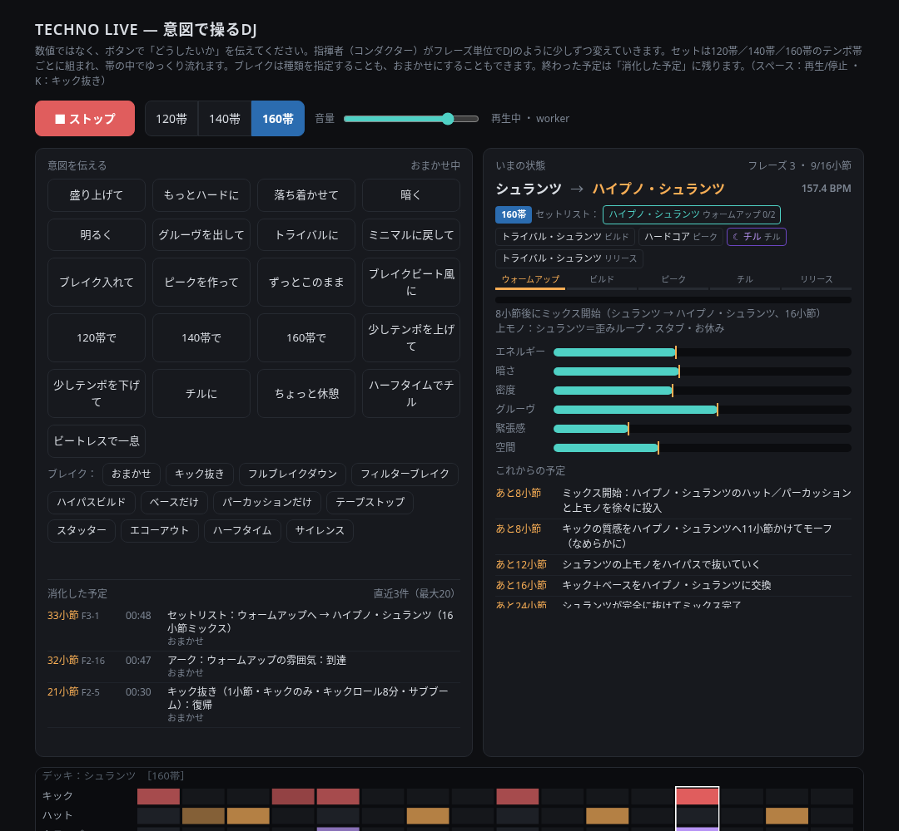
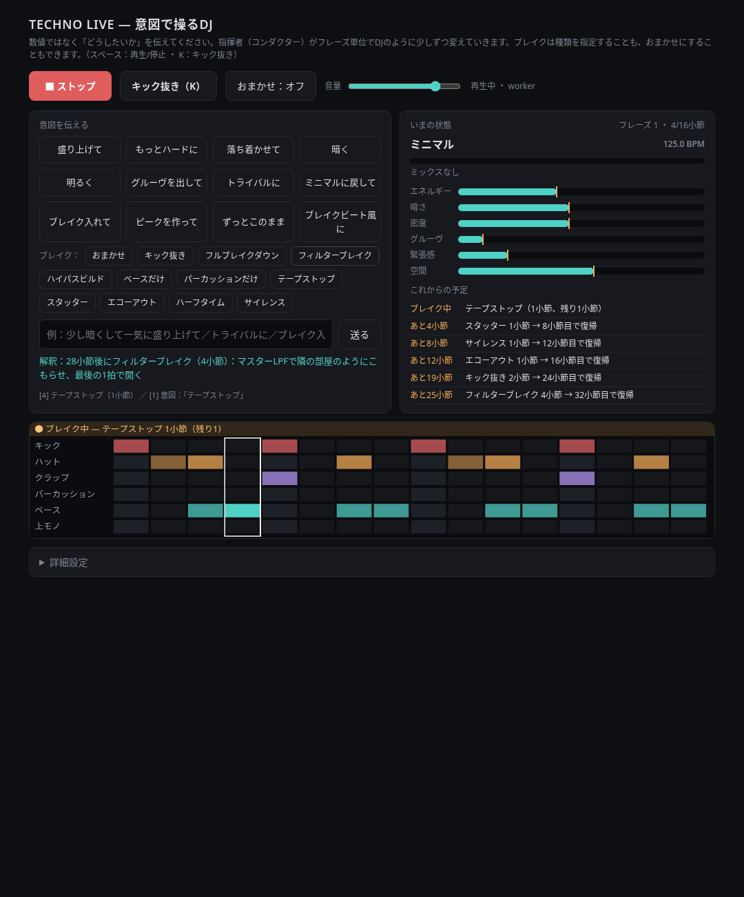

# techno-generator-1

ブラウザ上でリアルタイムに生成する Web Audio のテクノです。数値をいじるのではなく、「盛り上げて」「トライバルに」のような意図を伝えると、フレーズ単位で DJ のように少しずつ変化します。セットはチル帯、120帯、140帯のどれかに留まり、帯の中ではテンポをほとんど動かしません。スタートは 16 小節のオープニングから入り、ストップはクロージングを経て止まります。

## ライブ（`live/index.html`）

`live/index.html` をブラウザで開きます。外部ライブラリは不要で、Web Audio だけで動きます。

- **Space**: スタート / ストップ。ストップはすぐには止まらず、クロージングに入ります。クロージング中にもう一度押すと、約 20 ms で止まります
- **K**: 手動のキック抜き。短く押すと入り、もう一度押すか長押しのあとで戻ります。ブレイク列の「キック抜き」はレシピ付きの予定で、この操作とは別です
- **テンポ帯**: スタートボタンの横の「チル帯」「120帯」「140帯」、または意図ボタンの「チル帯で」「120帯で」「140帯で」。ビートレスのブリッジを挟んで帯を移します。帯の中のスタイル変更ではテンポ帯は変わりません
- **意図ボタン**: 盛り上げて、もっとハードに、落ち着かせて、暗く、明るく、グルーヴを出して、トライバルに、ミニマルに戻して、ブレイク入れて、ピークを作って、ずっとこのまま、ブレイクビート風に、チル帯で、120帯で、140帯で、少しテンポを上げて、少しテンポを下げて、チルに、ちょっと休憩、ハーフタイムでチル、ビートレスで一息。意図はこのボタンだけで渡します
- **ブレイク**: 意図ボタンの下に種類のボタンが並びます。「おまかせ」か、下の 11 種類から直接選べます。キック抜きは長さ・抜き方・フィル・ライザー・インパクトの組み合わせが毎回変わります（下記）
- **おまかせ**: 常にオンです。オン／オフのボタンはなく、止める操作もありません。「ずっとこのまま」は次の意図が来るまで一時停止するだけで、そのあとまた動きます
- **消化した予定**: 意図カードの下。終わった予定と取り消した予定が残ります（下記）

スタートは 120帯・ミニマルです。キーとモードはセットごとに決まり、スタイル行の右に出ます（下記）。スタイルの表示名は帯で変わります。チル帯はディープ・ミニマル、ダブテクノ、オーガニック・ローファイ、ダウンテンポ（ハーフタイム）、アンビエント・テクノ。120帯はミニマル、トライバル、ブロークン、グルーヴィー、インダストリアル。140帯はハイプノティック、ピークタイム・トライバル、ブロークン（速め）、ハードグルーヴ、ハードテクノです。



## オープニングとクロージング

スタートは 16 小節のオープニングです。パッドのドローンとこもったパーカッションから始まり、5 小節目にハット、9 小節目にクラップと上モノが入ります。ローパスは少しずつ開き、最後はライザーとクラッシュを付けて、17 小節目の頭でキックが入ります。

ストップ（または Space）はクロージングです。次のフレーズ境界で終わり、押してから 16〜31 小節あとです。エネルギーと密度を下げ、最後の 8 小節はアウトロです。キックとベースを抜いてエコーを残し、ローパスを閉じ、クラップ、ハット、上モノ、パーカッションの順に抜きます。終わると 5 秒かけて余韻をフェードし、エンジンが止まります。予定していたミックス、ブレイク、帯の変更は取り消します。クロージング中にもう一度押すと、約 20 ms で即停止します。

テストは `live/index.html?noopening` でオープニングを飛ばせます。

## テンポ帯とセットリスト

セットはひとつのテンポ帯に留まります。初期値は 120帯です。

| 帯 | 範囲 | 始まり |
| --- | --- | --- |
| チル帯 | 110–122 BPM | 114 BPM、アンビエント・テクノ |
| 120帯 | 121–130 BPM | 123.5 BPM、ミニマル |
| 140帯 | 134–148 BPM | 137 BPM、グルーヴ |

帯はチル帯、120帯、140帯の 3 つです。テンポの上限は 140帯の 148 BPM です。「もっと速く」は 1 段上の帯（チル帯から 120帯、120帯から 140帯）へ移し、140帯では 148 BPM までです。

おまかせは常にオンで、ウォームアップ → ビルド → ピーク → リリースの弧に沿ってスタイルを選び、そのあいだにチルを挟みます。「ずっとこのまま」のあいだだけ、この進行は止まります。帯の中のテンポは、16 小節フレーズあたり 0.5 BPM までしか動きません。「少しテンポを上げて」「少しテンポを下げて」も帯の外には出ず、目標まで 1 フレーズ 1 BPM 以内で寄ります。

120帯と 140帯のキックは、約 85% が 4 つ打ちです。ブロークンのキックは 8〜16 小節のフレーバーだけで、4 つ打ちのあいだにまれに入ります。チル展開は短く、入れる回数も少なくしました。

帯を変えるのは、帯ボタンか「チル帯で」「120帯で」「140帯で」（「ハイテンポで」「ゆったりめのセット」も同じ）を押したときだけです。どの帯のあいだも、下のビートレスのブリッジです。

- **下げる**: エコーアウトかテープストップで落とし、6 小節のアンビエント・ブリッジ（キックなし）のあいだにテンポを移し、新しいテンポで叩き込みます
- **上げる**: 8 小節のブリッジです。ライザーとスネアロールを付けて、新しいテンポで戻します

チル帯の弧はウォームアップ 113、ビルド 115.5、スウェル 118、リリース 114.5 です。ピークの代わりに緩いスウェルで、途中にチル展開は挟みません。キック抜きは短めの穏やかな組み合わせだけです。テープストップ、スタッター、サイレンス、ハイパスビルドは使いません。

## チル

おまかせは今のテンポ帯のまま、途中にチルを挟みます。チル帯では挟みません。BPM は変えません。おまかせの本体は 8 小節か 16 小節で、ビートレスは 8 小節です。ボタンで入れたときは、本体が 16 小節か 32 小節、ビートレスは 16 小節です。

入りは 8 小節のランプダウンのあと、1 小節のエコーアウトです。出るときは 8 小節のランプアップのあと、2 小節のキック抜き（ライザーとクラッシュ）を置き、ダウンビートで元のグルーヴに戻します。

中身は次のどれかです。

- 丸いキックの 4 つ打ち
- ハーフタイム
- ビートレス

どれもハットとクラップは少なく、ベースはまばらです。暖かいマイナー 9 のパッドとダブ・ディレイが乗り、上モノはチル用の 3 パッチ（チル・キー、ダブ・コード、ソフト・ベル）に替わります。

置く場所は次のとおりです。

- ピークのあと: 45%
- ビルドとビルドのあいだ: 20%
- ピークとピークのあいだ: 15%
- 128 小節チルがなければ、次のビルドかリリースの前に必ず入れる
- 最初の 64 小節には入れない
- あいだは 96 小節以上あける

セットリストには「☾チル」、進行バーには「チル」が出ます。入る、本体、戻るは「消化した予定」にも残ります。

自分から入れるボタンは「チルに」「ちょっと休憩」「ハーフタイムでチル」「ビートレスで一息」です。

## キックの質感

スタイルをミックスするあいだ、キックのドライブ、ランブル、減衰、ピッチは小節ごとに少しずつ移ります。質感が大きく違う組み合わせでは、交換の前に 2 小節以上キックを抜き、その隙間で差を隠します。音量はスタイルごとに揃えます。

デッキごとにドラムキットを持ちます。ハットは 5 種（タイト、オープン、909 メタル、シェイカー、ライド）と 5 つのパターン（裏打ち、8 分、16 分アクセント、ローリング 16 分、3-3-2）です。クラップは 4 種（タイト、ルーム、リム、クラップ＋スネア）で、フラムや先打ちが付くことがあります。パーカッションは 3 や 5、6、7 の周期のループを 2〜4 層持ちます。次のデッキは今のキットを避けて、交換でドラムの手触りが変わります。上モノ欄に今のキットが出ます。

飾りの量は、セットの局面とエネルギーで決まります。ピークでは多く、ウォームアップ、リリース、チルでは少なくなります。ピークのあと、ビルドの始まり、新しいデッキのあとには、8〜16 小節のストリップが入ります。そのあいだはキック、ベース、素のハットだけです（パーカッションが 1 つ残ることもあります）。16 小節の境目で同時に変わる要素は 1 つか 2 つです。フィル、フラム、先打ちはフレーズの終わりに寄せます。上モノ欄にストリップの残り小節が出ます。

## キー、ハーモニー、メロディ

キーは F から B のルート（Fm、F#m、Gm、G#m、Am、A#m、Bm）だけです。いちばん出やすいのは Am です。画面には `キー Am（8A）・エオリアン` のように、キー名、カメロット番号、モードが出ます。次のデッキのキーが違うときは、矢印で予告します。

モードはほとんどエオリアンです。ハードではときどきフリジアン、グルーヴとチル帯ではときどきドリアンが入ります。

キーを動かすのは、スタイルのミックスでキックとベースが入れ替わるときと、帯を移すビートレスのブリッジの中です。入れ替わりの約 3 割（帯のブリッジでは約 4 割）だけで、動く先は近いキー（5 度、全音、半音）で、ルートは F〜B のままです。変わったことは「消化した予定」に残ります。ベースはそのキーのルートに従い、音域は A マイナーのときと同じ高さです。

デッキごとにコード進行があります。1 コードは基本 4 小節で、ミニマルとハードはときどき 8 小節です。32 小節ごとに進行を選び直し、モードにない音は使いません。上モノ、ベース、パッド、チルのコードは同じ進行に沿います。

上モノのモチーフは、スケール上を順次で歩くマルコフです。8 小節は問いと答えで、休符の小節もあります。問いの終わりは主音を外し、答えは解決します。変奏は元のリズムか輪郭を残して派生させます。音ごとにベロシティ、長さ、フィルターが少しずれ、まばらでないときはゴーストノートが入ります。

ベースラインもシードから作ります。2 小節のコールとアンサーで、4 小節ごとに隣の音へ少し動きます。4 小節目にはターンアラウンドのフィルが入ることがあります。

## 上モノ

120帯と 140帯は各スタイル 5 パッチ、チル帯は 4 パッチです。パッチとセクション（お休み / まばら / メイン / 強め）は 16 小節の境目で、その回にリードが変わるときだけ選び直します。モチーフは 8 小節ごとに展開します（移調、ずらし、音の増減、オクターブ、アクセント、ゲートやフィルター）。音高の歩き方は前の節のとおりです。

ミックスでは、出る側の上モノとパッドがキックとベースの交換まで鳴り、入る側は交換から入ります。リードとチップチューンは今のコードに沿い、強い拍の長い音はコードトーンに寄せます。半音やトライトーンでぶつかる音は、ベースも同じように寄せます。パッドは三和音と短7に絞り、9度やモードの色の音は置きません。同時に鳴るメロディの層も抑えます。

まばらなセクションは、モチーフのリズムを種から間引いて鳴らします。小節ごとに形は変わりますが、同じモチーフのままです。コールは小節の前半、アンサーは後半を残し、8 小節か 16 小節で密度が呼吸します。裏拍の先取りと、フレーズ終わりのピックアップも入ります。クラシックのパッチも、まばらのときはその音色で同じリズムを弾きます。

グルーヴのオルガンは、M1 風のドローバー（8′、4′、2 2/3′、2′）を 2 本ずらして重ね、キークリックと減衰を付けました。弾き方は短いスタブ、ロータリー、柔らかいスウェルです。コードは転回形でつなぎ、音を 3 つに減らすこともあります。ほかのパッチよりまれにしか選ばれず、16 小節で別のパッチに替わります。

おまかせはときどき、チップチューンのスパイスに切り替えます。そのあいだ、いつもの上モノは休みます。パルス（デューティ 12.5 / 25 / 50%。チル帯は三角波）のリードか、コードトーンのアルペジオで、ノイズのティックも入ります。音は今のキーとモードの中です。長さは 8 小節か 16 小節で、入りと終わりはフェードします。オープニングとクロージングでは鳴らしません。上モノ欄と「消化した予定」に出ます。

おまかせはときどき、8 小節か 16 小節のジャジーなフレーバーにも切り替えます。そのあいだ、いつものリードは休み、ローズ風のエレピが今のコードの m9 / m11（ルートなし）を弾きます。軽くスウィングしたライドかシェイカーが乗り、ブラシが入ることもあります。ベースはときどき 4 分のウォーキングになり、キックは 4 つ打ちのままです。入りと終わりはフェードします。オープニング、クロージング、チップチューンとは重なりません。120帯とチル帯で出やすく、140帯ではまれです。上モノ欄と「消化した予定」に出ます。

ジャジーのあいだは、キックを 4 つ打ちのまま、ハット、クラップ、パーカッション、ベース、ライドを同じスウィングに揃えます。1 小節かけて入り、終わりも戻します。パッドはルートと 5 度の殻になり、3 度、7 度、テンションはエレピが弾きます。コードは小節頭でエレピ、パッド、ベースが一緒に替わります。ミックス、ブレイク、キック抜き、チル、帯の移動とは重ならず、予定の 2 小節前にフェードで抜けます。パッドは 700 Hz 付近を少し下げ、エレピは低い中域を切り、リバーブとディレイは控えめです。

- **ミニマル**: ダブ・スタブ、ダブ・コード（m9）、サイン・ブリープ、グラス・ベル、ヒプノ・シーケンス
- **ハード**: ディストーション・スタブ＋アシッド、アシッド・ライン、サイレン・リード、フーバー、メタル・パーカッション
- **グルーヴ**: オルガン＋ボイス、クラビ、ブラス・スタブ、ハウス・ピアノ、ボイス・チョップ
- **トライバル**: マリンバ＋フルート、カリンバ、ログドラム、チャント、バンブー・フルート
- **ブロークン**: パルス・アルペジオ、エレクトロ・ザップ、スクエア・コード、アシッド、ブリープ

チル帯の 4 パッチは次のとおりです。

- **ディープ・ミニマル**: ディープ・キー、サイン・ブリープ、グラス・ベル、ダブ・コード（m9）
- **ダブテクノ**: ダブ・コード（m9）、ダブ・スタブ（こもり）、チル・キー、ソフト・ベル
- **オーガニック・ローファイ**: カリンバ、バンブー・フルート、ログドラム、ウッド・マレット
- **ダウンテンポ（ハーフタイム）**: ローファイ・キー、ヴィブラフォン、チル・キー、ダブ・スタブ（こもり）
- **アンビエント・テクノ**: パッド・スウェル、シマー、グラス・ベル、ソフト・ベル

## キック抜きのレシピ

「ブレイク入れて」やおまかせのキック抜きは、長さ（半拍、1 拍、1 / 2 / 4 / 8 小節）、位置（フレーズの終わり、または途中のピックアップ）、抜き方（キックのみ、キック＋ベース、ローカット、細いキック、1 拍目だけ、裏打ち）、フィル、ライザー（ノイズ / ピッチ / なし）、インパクト（クラッシュ、サブブーム、両方、なし）を組み合わせます。直前と同じ組み合わせは続けません。

## ブレイク（11 種類）

「ブレイク入れて」は種類を指定しません。今のエネルギーとスタイルに合うものを自動で選び、直前と同じ種類は避けます。種類を決めるときはブレイク列のボタンを押します。

| 種類 | 内容 |
| --- | --- |
| キック抜き | キックだけ抜いてライザーで溜める |
| フルブレイクダウン | ドラムとベースが抜け、上モノとパッドだけ。最後の 2 小節でスネアロールとライザー |
| フィルターブレイク | マスターのローパスでこもらせ、最後の 1 拍で開く |
| ハイパスビルド | ハイパスで全体を細くし、最後の小節はキックとベースを抜く |
| ベースだけ | キックとベースだけを残す |
| パーカッションだけ | ハット、クラップ、パーカッションだけを残す |
| テープストップ | 後半 2 拍でピッチダウンして止まり、次の 1 拍目で再始動 |
| スタッター | 後半 2 拍を 8 分、16 分、32 分で連打する |
| エコーアウト | ドライを切ってダブ・ディレイの残響だけを残す |
| ハーフタイム | キックは 1 拍目、スネアは 3 拍目。ベースも半分の速さ |
| サイレンス | 最後の 1 拍だけほぼ無音にしてドロップ |



## 消化した予定

スタート後、終わった予定と途中で取り消した予定が「消化した予定」に残ります。新しいものが上で、直近 20 件です。各行は次の 4 つです。

- **小節 / フレーズ**: 何小節目かと、16 小節フレーズの位置（例: `12小節` と `F1-12`）
- **時刻**: スタートからの `mm:ss`
- **内容**: 何が起きたか。取り消したものは「取消」
- **きっかけ**: 押した意図ボタン（「盛り上げて」のように引用）、ブレイクのボタン（ボタン「テープストップ」など）、おまかせ、手動（K）

## テスト（`live/test/`）

Playwright で `live/index.html` を開く Node テストです。`smoke5.mjs` は操作の通し、`shot.mjs` はスクリーンショット、`dj_offline.mjs` は意図をスクリプトしたオフラインレンダー、`drop_analysis.mjs` はキック抜きの解析です。ブレイク用に次を追加しています。

- `smoke6_breaks.mjs` — 全種類をボタンで通し、ミックス中の指定も見る。スクリーンショットは `screenshot_break.png`
- `smoke7_log.mjs` — 「消化した予定」の件数、新しい順、取消、きっかけを、スケジューラと画面の両方で見る
- `intent_breaks.mjs` — 「ブレイク入れて」や種類名が、どのブレイクになるかの対応
- `break_analysis.mjs` — 各ブレイクをオフラインでレンダーし、ピーク、復帰のダウンビート、プローブの連続性を見る
- `v8_sets.mjs` — 120帯 / 140帯の長めのおまかせで、フレーズあたりのテンポ変化、セットリストの弧、上モノの展開、キック抜きの重複のなさを見る。帯の切り替えはビートレスかも見る。引数は `tempo`、`band`、`all`（省略時は `all`）
- `v8_kickmorph.mjs` — ミックス中のキック質感を、ヒットの帯域エネルギーとキック同士の変化量で測る。比較用に `index.v7.bak.html` も開く
- `v9_chill.mjs` — 両帯の長めのおまかせで、チルの間隔、エネルギー、ハットとキックの少なさを見る。指定したチルは入りと復帰のダウンビートを見る。引数は `long`、`demand`、`all`（省略時は `all`）
- `v11_openclose.mjs` — 各帯のオープニング（キックが 17 小節目に入ること）とクロージング（フレーズ境界、キックアウト、余韻、予定の取消、即停止）を見る。引数は `offline`、`live`、`all`（省略時は `all`）
- `v11_chillband.mjs` — チル帯の長めのおまかせで、テンポ、穏やかなキック抜き、チル展開を挟まないこと、エネルギーを見る。他の帯とのブリッジも見る。引数は `set`、`level`、`band`、`all`（省略時は `all`）
- `v13_melody.mjs` — 各帯の長めのおまかせで、上モノ・ベース・パッドの繰り返し、音程の動き、キーの変化をスケジューラだけで測る。シードを変えたときの近さも見る。引数はラベル、HTML のパス、小節数（省略時 256）、シード数（省略時 3）
- `v14_keys.mjs` — 各帯で、キーが F〜B に収まること、Am の出やすさ、エオリアン中心のモード、入れ替わり時のキー変化の割合と近さ、ベースの音域を見る。引数はラベル、HTML のパス、開始キーのシード数（省略時 300）、シミュレーションのシード数（省略時 8）、小節数（省略時 384）
- `v15_chip.mjs` — 各帯のおまかせで、チップチューンが 8〜16 小節、キー内、オープニングとクロージングの外に入るかを見る。強制したオフラインレンダーのピークも見る。引数はシード数（省略時 6）、小節数（省略時 480）
- `v16_balance.mjs` — 各帯の長めのおまかせで、4 つ打ち・ブロークンのキック・チル・ブレイクの割合と、フレーバーとチルの長さを見る。引数はラベル、HTML のパス、シード数（省略時 6）、小節数（省略時 448）
- `v17_no160.mjs` — 画面と帯の一覧から 160帯が消えていること、「もっと速く」が 1 段上の帯へ移ること、140帯のテンポが 148 BPM を超えないことを見る
- `v18_dissonance.mjs` — 長めのおまかせで、短2度やトライトーン、ミックス中の別キー、コード外のリード、同時に鳴る上モノの層を測る。引数はラベル、HTML のパス、小節数（省略時 384）、シード数（省略時 4）
- `v19_sparse.mjs` — まばらな上モノのリズムの繰り返しと、オルガンの出にくさ、他の上モノと比べた音色を見る。引数はラベル、HTML のパス、小節数（省略時 384）、シード数（省略時 4）
- `v20_jazz.mjs` — 各帯のおまかせで、ジャジーが 8〜16 小節、キー内、オープニング・クロージング・チップチューンの外に入り、キックが 4 つ打ちのままかを見る。強制したオフラインレンダーのピークも見る。引数はシード数（省略時 6）、小節数（省略時 480）
- `v21_drums.mjs` — 各帯の長めのおまかせで、ハット・クラップ・パーカッションのパターンと音色の変化、フレーズ境界とデッキ交換での入れ替わり、同時に鳴る層の数を見る。引数はラベル、HTML のパス、シード数（省略時 5）、小節数（省略時 384）
- `v22_jazzmesh.mjs` — 各帯で、ジャジー中のスウィングのずれ、ミックス・ブレイク・チル・入れ替わり・キー変化との重なり、エレピとパッドの帯域を見る。引数はラベル、HTML のパス、シード数（省略時 4）、小節数（省略時 384）
- `v23_contrast.mjs` — 各帯の長めのおまかせで、小節ごとの飾りと密度のばらつき、ストリップ、16 小節境目の変化数、フレーズ途中との差を見る。引数はラベル、HTML のパス、シード数（省略時 5）、小節数（省略時 448）

```bash
cd live/test
npm install
npx playwright install chromium
node smoke5.mjs
node smoke6_breaks.mjs
node smoke7_log.mjs
node intent_breaks.mjs
node break_analysis.mjs
node shot.mjs
node dj_offline.mjs          # 短縮は node dj_offline.mjs quick
node drop_analysis.mjs /path/to/live/index.html
node v8_sets.mjs            # tempo | band | all
node v8_kickmorph.mjs
node v9_chill.mjs           # long | demand | all
node v11_openclose.mjs      # offline | live | all
node v11_chillband.mjs      # set | level | band | all
node v13_melody.mjs         # ラベル、HTML、小節数、シード数
node v14_keys.mjs           # ラベル、HTML、シード数、シミュレーション、小節数
node v15_chip.mjs           # シード数、小節数
node v16_balance.mjs        # ラベル、HTML、シード数、小節数
node v17_no160.mjs
node v18_dissonance.mjs      # ラベル、HTML、小節数、シード数
node v19_sparse.mjs          # ラベル、HTML、小節数、シード数
node v20_jazz.mjs            # シード数、小節数
node v21_drums.mjs           # ラベル、HTML、シード数、小節数
node v22_jazzmesh.mjs        # ラベル、HTML、シード数、小節数
node v23_contrast.mjs        # ラベル、HTML、シード数、小節数
```

各スクリプトはページを `file:///workspace/techno/live/index.html` として開き、Chrome を `/usr/bin/google-chrome` から起動します。`smoke5.mjs`、`smoke6_breaks.mjs`、`smoke7_log.mjs` は `?noopening` を付けてオープニングを飛ばします。`break_analysis.mjs` は引数で HTML のパスを渡せます。`smoke5.mjs` と `shot.mjs` は `live/test/screenshot.png` を、`smoke6_breaks.mjs` は `live/test/screenshot_break.png` を上書きします。

## 公開

ライブの URL は https://mugentechno.sameharu.me/ です。https://techno-generator.sameworker.workers.dev でも同じサイトを開けます。リポジトリのルートで次を実行すると、`live/` を Cloudflare Workers の静的サイトとしてデプロイします。

```bash
npm i && npx wrangler deploy
```

`live/.assetsignore` が `test/` とバックアップをサイトから外します。
